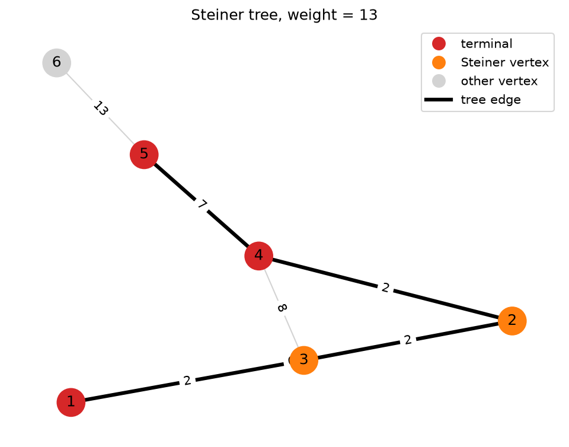

# steiner-tree

A Python implementation of a shortest-path heuristic (Takahashi–Matsuyama) for the Steiner tree problem in graphs.

## Problem

Given an undirected, edge-weighted graph $G = (V, E, w)$ and a set of terminals $T \subseteq V$, find a tree $S \subseteq G$ that connects all terminals and has minimum total weight

$$
w(S) = \sum_{e \in E(S)} w(e).
$$

The tree may include non-terminal vertices, called *Steiner vertices*, when that makes it cheaper. The problem is NP-hard, so this repository uses a greedy heuristic.

## Algorithm

`greedy.py` implements the shortest-path heuristic:

1. **All-pairs shortest paths.** Run Floyd–Warshall on the adjacency matrix. This gives a distance matrix $d(u,v)$ and a predecessor matrix used to rebuild paths. Cost: $O(|V|^3)$ time and $O(|V|^2)$ memory.
2. **Start.** Set $S = \{t_0\}$ for any terminal $t_0 \in T$.
3. **Grow.** While some terminals are still outside $S$:
   - choose the terminal $t \in T \setminus S$ and the tree vertex $s \in S$ that minimise $d(t, s)$;
   - add every vertex and edge on the shortest $s \to t$ path to $S$.
4. **Validate.** Run a DFS to check that $S$ has no cycles, is connected, and contains every terminal.

In the worst case the heuristic returns a tree of weight at most $2\,(1 - 1/|T|)$ times the optimum.

## Requirements

- Python 3
- `numpy`
- `rustworkx` (graph layout and drawing)
- `matplotlib` (for drawing)

```bash
pip install numpy rustworkx matplotlib
```

## Usage

```bash
python greedy.py [input_file] [--save image.png] [--no-show]
```

| Argument           | Meaning                                           |
|--------------------|---------------------------------------------------|
| `input_file`       | STP file to read (default: `test.txt`)            |
| `--save image.png` | save the drawing to a file                        |
| `--no-show`        | don't open a plot window (useful together with `--save`) |

Examples:

```bash
python greedy.py                                   # test.txt, opens a window
python greedy.py test2.txt
python greedy.py test2.txt --save tree.png --no-show
```

The script prints:

1. the adjacency list of the Steiner tree it found (`vertex: (neighbour, weight) ...`),
2. the set of terminals,
3. the total weight of the tree,
4. `True`/`False`: whether the result is a valid Steiner tree.

**Vertex indices in the printed output are 0-based.** The input file uses 1-based indices, and the loader subtracts 1 from each. The drawing labels vertices 1-based, to match the input file.

## Drawing



## Input format

The input uses the [SteinLib](http://steinlib.zib.de/format.php) STP format. Only these keywords are parsed:

| Line                | Meaning                                       |
|---------------------|-----------------------------------------------|
| `Nodes n`           | number of vertices                            |
| `Edges m`           | number of edges (read but not used)           |
| `E u v w`           | undirected edge between `u` and `v`, weight `w` (integer) |
| `Terminals k`       | number of terminals (read but not used)       |
| `T t`               | vertex `t` is a terminal                      |

All other lines (`SECTION`, `END`, `Name`, comments, and so on) are ignored. This means SteinLib benchmark instances can be used directly.

### Example (`test.txt`)

```
SECTION Graph
Nodes 6
Edges 7
E 1 2 6
E 1 3 2
E 2 3 2
E 2 4 2
E 3 4 8
E 4 5 7
E 5 6 13
END

SECTION Terminals
Terminals 3
T 1
T 4
T 5
END
```

## Code structure

- **`Graph`** stores the input graph three ways: an adjacency list, an adjacency matrix (`numpy`, with `inf` for missing edges) and a `rustworkx.PyGraph`. It also holds the terminal set and the shortest-path cache.
  - `add_edge(v1, v2, w)`, `add_terminal(v)`
  - `min_distances()`, `min_paths()`: compute (and cache) the Floyd–Warshall results, then print and return them
  - `find_steiner_tree()`: the greedy construction
  - `add_path_to_stein_tree(v1, v2)`: rebuilds the shortest path from the predecessor matrix and adds it to the tree
  - `is_steiner_tree_valid()`: checks for cycles, connectivity and terminal coverage
  - `steiner_tree_weight()`: total weight of the tree
  - `draw_steiner_tree(filename=None, show=True, seed=42)`: draws the graph with the tree highlighted; returns the matplotlib `(fig, ax)`
- **`Steiner`** is the tree being built: a vertex set, an adjacency list and a list of edges.

Adding an edge or a terminal invalidates the cached shortest paths and tree.

## Limitations

- With parallel edges, the adjacency matrix keeps the **last** edge between two vertices, not the cheapest one.
- Runs in pure Python loops, which is slow for large SteinLib instances (more than about a few hundred vertices).

## References

- H. Takahashi, A. Matsuyama, *An approximate solution for the Steiner problem in graphs*, Math. Japonica 24 (1980) 573–577.
- SteinLib Testdata Library: http://steinlib.zib.de/
